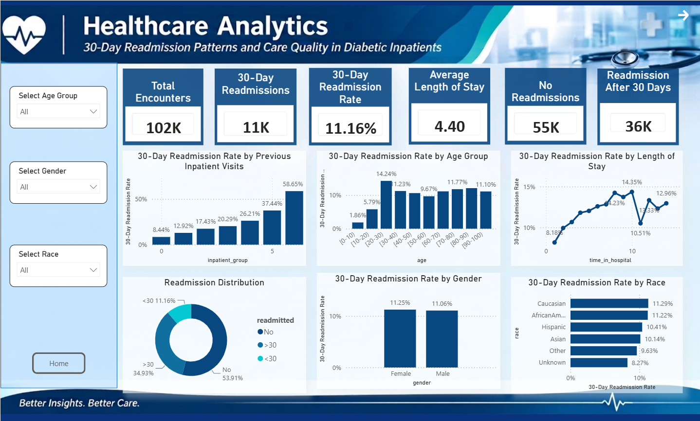
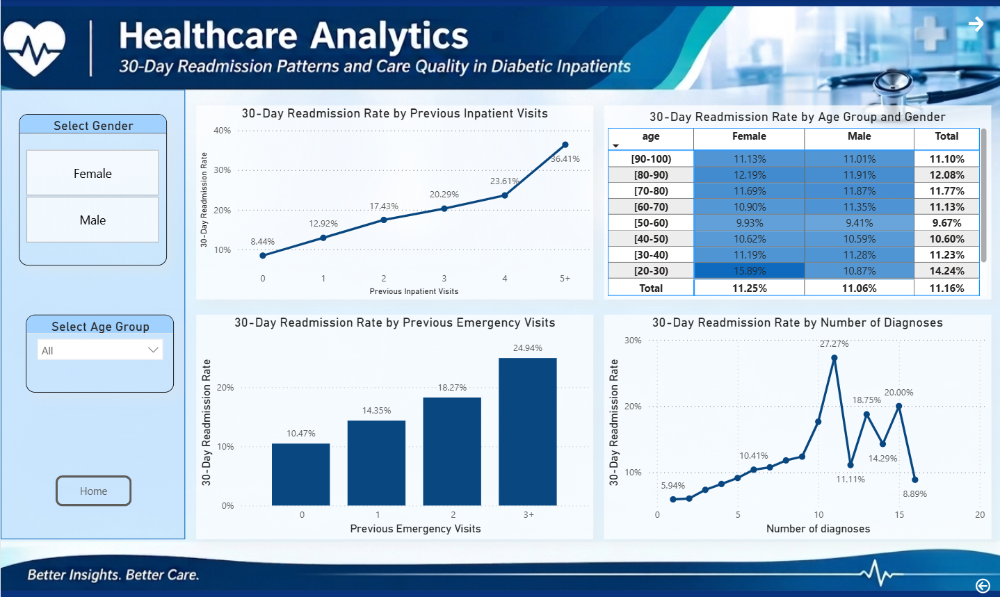
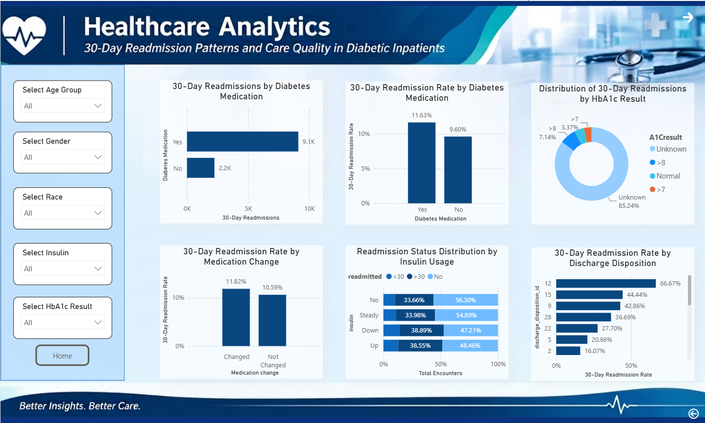
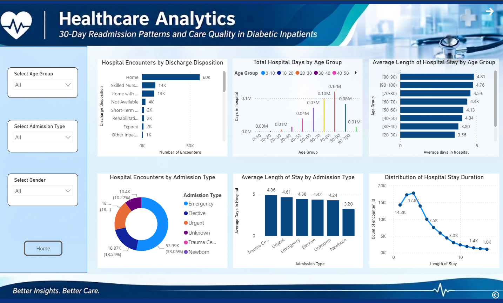
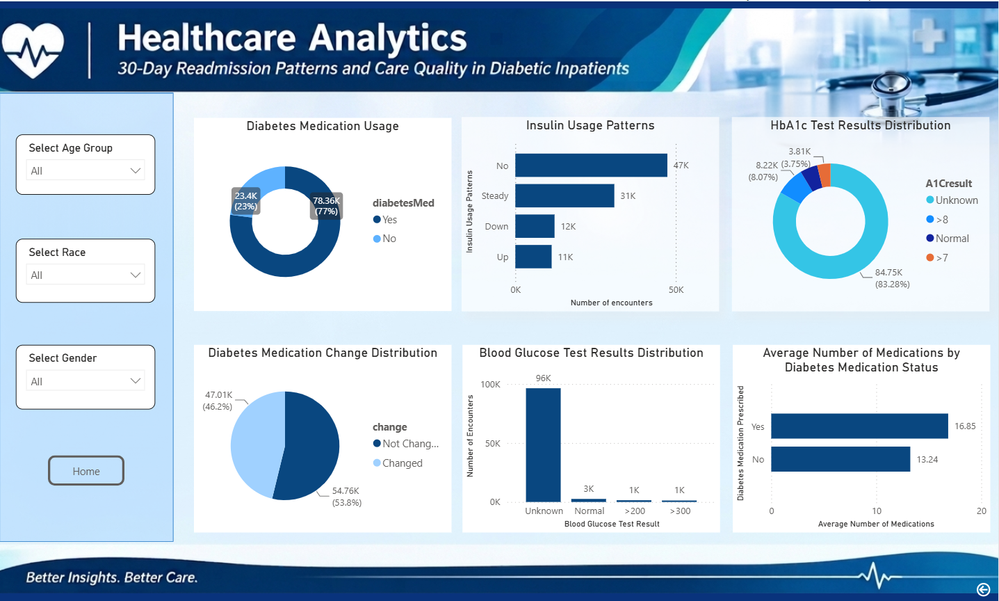

# Healthcare Analytics: 30-Day Readmission Patterns and Care Quality in Diabetic Inpatients

**Exploring hospital readmission patterns to support data-driven insights into diabetes care and healthcare resource planning.**

## Project Overview

Diabetes management often requires continuous monitoring, appropriate treatment, and follow-up care. When patients return to the hospital after discharge, it can create additional challenges for patients, healthcare professionals, and hospital resources.

This project explores hospital encounter data to understand **patterns associated with readmission among patients with diabetes**, with particular attention to readmissions within 30 days of discharge.

Using the *Diabetes 130-US Hospitals for Years 1999–2008* dataset, the project aims to identify patterns across patient demographics, hospital stays, previous inpatient visits, diagnoses, and treatment-related information.

The goal is to turn a large healthcare dataset into meaningful, evidence-based insights that can support further investigation into patient outcomes and healthcare resource planning.

## Business Problem

Hospital readmissions can place additional pressure on healthcare systems and affect patients' recovery journeys. Understanding which patient groups and hospital encounters are associated with different readmission outcomes may help healthcare professionals identify areas that deserve closer attention.

This project addresses the following question:

**What patterns in patient characteristics, hospital utilization, diagnoses, and treatment information are associated with readmission among diabetic inpatients, particularly within 30 days of discharge?**

The analysis will explore these relationships while recognizing that readmission alone does not determine the quality of care a patient receives.

## Project Objectives

- Analyze the distribution of readmission outcomes, including readmission within 30 days, readmission after 30 days, and no recorded readmission in the dataset's defined categories.
- Explore how patient demographics, including age and gender, relate to readmission patterns.
- Examine hospital utilization indicators such as length of stay and previous inpatient visits.
- Investigate patterns across diagnoses, procedures, and medication-related variables.
- Compare readmission outcomes across relevant patient and encounter groups.
- Develop clear visualizations to communicate findings and support data-driven discussion.

## Dataset Information

| Attribute | Details |
|---|---|
| Dataset | Diabetes 130-US Hospitals for Years 1999–2008 |
| Source | UCI Machine Learning Repository |
| File format | CSV |
| Number of records | 101,766 |
| Number of columns | 50 |
| Unit of observation | Hospital encounter |
| Domain | Healthcare Analytics |

**Dataset source:** [UCI Machine Learning Repository – Diabetes 130-US Hospitals](https://archive.ics.uci.edu/dataset/296/diabetes+130-us+hospitals+for+years+1999-2008)

The dataset contains hospital encounter information for patients with diabetes across multiple U.S. hospitals during 1999–2008. It includes demographic details, diagnoses, procedures, medications, hospital utilization indicators, and readmission status.

### Key Fields

Some of the fields relevant to this project include:

- `age` – Patient age group
- `gender` – Recorded gender
- `time_in_hospital` – Length of hospital stay
- `num_lab_procedures` – Number of laboratory procedures
- `num_procedures` – Number of procedures other than laboratory tests
- `num_medications` – Number of medications
- `number_inpatient` – Previous inpatient visits
- `diag_1`, `diag_2`, `diag_3` – Recorded diagnosis fields
- `readmitted` – Recorded readmission category

Each row represents a **hospital encounter**, not necessarily a unique patient. A patient may have more than one encounter in the dataset.

## Tools and Technologies

- **Python** – Data analysis
- **Pandas** – Dataset loading, inspection, and tabular analysis
- **NumPy** – Numerical operations
- **Matplotlib** – Data visualization
- **Jupyter Notebook** – Interactive analysis and documentation
- **GitHub** – Version control and project presentation

## Project Workflow

The project will follow a structured data analysis workflow:

1. **Understand the data:** Load the dataset and inspect its dimensions, column names, data types, and sample records.
2. **Prepare for analysis:** Review relevant fields and assess data quality before conducting detailed analysis.
3. **Explore readmission patterns:** Examine the distribution of readmission outcomes and compare relevant patient and encounter groups.
4. **Analyze contributing patterns:** Explore relationships involving demographics, hospital stays, previous admissions, diagnoses, and treatment-related information.
5. **Visualize insights:** Use appropriate charts and summaries to communicate patterns clearly.
6. **Interpret findings:** Discuss what the analysis suggests, along with its limitations and potential business relevance.

## Planned Analysis

The main areas of investigation are:

| Analysis Area | Key Questions |
|---|---|
| Readmission patterns | How are encounters distributed across the recorded readmission categories? |
| Patient demographics | How do readmission patterns vary across age groups and gender? |
| Hospital utilization | Are length of stay and previous inpatient visits associated with readmission outcomes? |
| Diagnoses and treatment | What patterns appear across diagnosis, procedure, and medication-related fields? |
| Comparative analysis | Which patient or encounter groups show different readmission patterns? |
| Data visualization | How can these findings be communicated clearly to support decision-making? |

## Expected Business Value

The project aims to demonstrate how healthcare data can be used to:

- Identify patient and encounter groups that may warrant further investigation.
- Understand patterns in hospital utilization and readmission outcomes.
- Support discussions around discharge planning, follow-up care, and resource allocation.
- Present complex healthcare data through clear, accessible visualizations.
- Demonstrate a structured, evidence-based approach to solving a real-world analytical problem.

These are intended applications of the analysis, not claims that the dataset alone can establish the causes of readmission or measure overall care quality.

## Repository Structure

The repository will be organized as follows:

```text
Healthcare-Analytics/
│
├── data/
│   ├── raw/
│   │   └── diabetic_data.csv
│   │
│   └── processed/
│       └── df_cleaned.csv
│
├── notebooks/
│   ├── Healthcare_Analytics_Phase1.ipynb
│   ├── Healthcare_Analytics_Phase2.ipynb
│   ├── Healthcare_Analytics_Phase3_EDA.ipynb
│   └── Healthcare_Analytics_Phase4_Insights.ipynb
│
├── reports/
│   ├── Healthcare_Analytics_SRS.docx
│   └── Project_Insights.md
│
├── visualizations/
│   ├── univariate/
│   ├── bivariate/
│   └── multivariate/
│
├── README.md
│
└── requirements.txt
```

- data/raw/	    -          Original diabetic dataset
- data/processed/  -    	  Cleaned dataset after preprocessing
- notebooks/	 -           Separate notebooks for each project phase
- reports/	-              SRS and business findings
- visualizations/  -       Exported charts and graphs
- README.md	  -            Project overview, objectives, methodology and results
- requirements.txt -     	Python libraries required to run the project

## Scope and Limitations

- The dataset covers historical hospital encounters from **1999 to 2008**; findings may not reflect current healthcare practices.
- The analysis is based on the variables available in the dataset.
- Multiple encounters may belong to the same patient.
- Associations between patient or encounter characteristics and readmission do not establish causation.
- Readmission status alone is not a complete measure of healthcare quality.
- The project focuses on analytical insights and does not provide medical advice or individual patient recommendations.


# Phase 2 – Data Preprocessing & Cleaning

## Healthcare Analytics: 30-Day Readmission Patterns and Care Quality in Diabetic Inpatients

Data preprocessing is a critical step in transforming raw healthcare data into a reliable dataset for analysis.

In this phase, the Diabetes 130-US Hospitals dataset was cleaned and standardized using Python and Pandas. The objective was to improve data quality while preserving the complete dataset for further analysis of diabetic inpatient readmission patterns.

### Dataset

- **Dataset:** Diabetes 130-US Hospitals
- **Original Records:** 101,766
- **Original Features:** 50
- **Final Records:** 101,766
- **Final Features:** 50
- **Data Source:** UCI Machine Learning Repository

The original dataset was retained without removing any rows or columns.

### Data Preparation Workflow

The following preprocessing steps were performed:

| Step | Process | Outcome |
|---|---|---|
| 01 | Dataset inspection | Reviewed structure, columns, and data types |
| 02 | Missing-value assessment | Identified null and unknown values |
| 03 | Missing-value standardization | Replaced `?` with `NaN` and standardized unknown categories |
| 04 | Data type correction | Converted categorical identifiers to category datatype |
| 05 | Age category ordering | Established the correct age-group sequence |
| 06 | Duplicate validation | Confirmed no duplicate rows |
| 07 | Numerical validation | Checked selected numerical variables for negative values |
| 08 | Text standardization | Removed extra spaces and standardized selected labels |
| 09 | Medication review | Examined medication status categories |
| 10 | Final validation | Verified dataset consistency and completeness |

### Key Data Cleaning Decisions

**Missing and Unknown Values**

The dataset contained unknown values represented by `?`. These were standardized to `NaN` and subsequently represented as `"Unknown"` in applicable categorical and text columns.

This approach preserved patient encounter records without introducing assumptions about unavailable information.

**Categorical Data Types**

Admission type, discharge disposition, and admission source identifiers were converted to categorical data types because they represent coded categories rather than continuous numerical measurements.

The age column was converted into an ordered categorical variable to support meaningful age-group comparisons.

**Data Consistency**

Text formatting was standardized by removing leading and trailing spaces. Selected categorical labels were also normalized to maintain consistency across the dataset.

**Data Integrity**

Duplicate records were checked and no duplicates were identified. Selected numerical columns were also validated for negative values.

### Final Data Quality Results

| Quality Check | Result |
|---|---:|
| Original Dataset Shape | 101,766 × 50 |
| Cleaned Dataset Shape | 101,766 × 50 |
| Remaining Null Values | 0 |
| Remaining `?` Values | 0 |
| Duplicate Records | 0 |
| Rows Removed | 0 |
| Columns Removed | 0 |


### Outcome

The preprocessing phase established a consistent and validated dataset for subsequent analytical tasks.

The cleaned dataset maintains the complete original data structure while improving consistency in missing-value representation, categorical labels, and data types.

The resulting dataset is ready for exploratory data analysis, with a focus on:

- Patient demographics and age-group distribution
- Hospital utilization patterns
- Medication usage and treatment changes
- Readmission patterns within 30 days
- Factors associated with readmission outcomes


# Phase 3: Exploratory Data Analysis (EDA)

## Overview

The third phase of this project focuses on Exploratory Data Analysis (EDA) to identify patterns, trends, and relationships in diabetic inpatient hospital encounters.

The objective is to understand patient demographics, hospital utilization, diabetes management, and factors associated with 30-day hospital readmissions.

EDA was performed using three analytical approaches:

- Univariate Analysis
- Bivariate Analysis
- Multivariate Analysis

### Univariate Analysis

Univariate analysis was performed to understand the distribution and characteristics of individual variables.

The analysis covered:

- Readmission outcome distribution
- Patient age group distribution
- Gender distribution
- Race distribution
- Length of hospital stay
- Number of medications
- Number of laboratory procedures
- Previous inpatient visits
- Number of medical procedures
- Number of diagnoses
- HbA1c test result distribution
- Admission type distribution
- Discharge disposition distribution

#### Key Observations

- Most hospital encounters involved patients aged 70–80 years.
- The majority of hospital stays lasted between 1 and 4 days.
- Most encounters involved a relatively small number of medical procedures.
- The number of diagnoses was concentrated around 8 diagnoses, with approximately 49,474 encounters in that category.
- Approximately 83.3% of encounters had an Unknown HbA1c result.
- Emergency admissions accounted for approximately 53.05% of all encounters.
- Discharge to home was the most common outcome, representing approximately 59.19% of encounters.

### Bivariate Analysis

Bivariate analysis was performed to investigate the relationship between two variables, with particular emphasis on their association with 30-day readmission.

#### Analyses Performed

| No. | Analysis | Objective |
|---|---|---|
| 1 | Age Group vs. 30-Day Readmission | Examine readmission patterns across age groups. |
| 2 | Previous Inpatient Visits vs. 30-Day Readmission | Investigate whether previous hospitalizations are associated with readmission. |
| 3 | Length of Hospital Stay vs. 30-Day Readmission | Understand how hospital stay duration relates to readmission. |
| 4 | Discharge Disposition vs. 30-Day Readmission | Compare readmission rates across discharge destinations. |
| 5 | Number of Diagnoses vs. 30-Day Readmission | Investigate the relationship between diagnosis count and readmission. |

#### Key Observations

- The 20–30 age group recorded the highest readmission rate at approximately 14.24%.
- Readmission rates increased with previous inpatient admissions, reaching approximately 44.37% among encounters with eight previous inpatient admissions.
- Readmission rates generally increased with hospital stay duration, although the trend was not continuous.
- Patients discharged to rehabilitation facilities and skilled nursing facilities generally showed higher readmission rates than patients discharged directly home.
- Readmission rates generally increased as the number of diagnoses increased from 1 to 9.

### Multivariate Analysis

Multivariate analysis was performed to examine the combined relationship between three or more variables and identify patterns that may not be visible through individual comparisons.

#### Analyses Performed

| No. | Analysis | Visualization |
|---|---|---|
| 1 | Age Group vs. Length of Hospital Stay and Readmission Rate | Heatmap |
| 2 | Previous Inpatient Visits vs. Age Group and Readmission Rate | Grouped Bar Chart |
| 3 | Admission Type vs. Discharge Disposition | Heatmap |
| 4 | HbA1c Result vs. Medication Change and Readmission Rate | Grouped Bar Chart |
| 5 | Number of Medications vs. Age Group and Readmission Rate | Grouped Bar Chart |

### Key Observations

- Readmission rates among middle-aged and older patients were relatively stable across different hospital stay durations.
- Previous inpatient visits showed a strong association with readmission rates across most age groups.
- Readmission rates varied across combinations of admission types and discharge destinations.
- Encounters involving diabetes medication changes showed slightly higher readmission rates across HbA1c categories.
- Higher medication counts were associated with increased readmission rates in several age groups.
- Some unusually high readmission rates were observed in categories with small encounter counts and should be interpreted cautiously.

### Overall Key Insights

The exploratory analysis highlighted several important patterns:

1. **Previous Hospitalizations:** Patients with a history of repeated inpatient admissions showed substantially higher 30-day readmission rates.

2. **Patient Complexity:** A higher number of diagnoses and medications may indicate greater healthcare needs and a potential requirement for closer monitoring.

3. **Length of Stay:** Longer hospital stays were generally associated with higher readmission rates, although the relationship was not consistently increasing.

4. **Discharge Planning:** Readmission rates varied across discharge destinations, highlighting the importance of coordinated post-discharge care.

5. **Diabetes Monitoring:** The high proportion of Unknown HbA1c results highlights an opportunity to investigate diabetes monitoring and test documentation practices.

6. **Medication Management:** Slightly higher readmission rates among encounters involving medication changes suggest the importance of medication reconciliation and follow-up care.


### Conclusion

The EDA phase provided valuable insights into 30-day hospital readmission patterns among diabetic inpatients.

Previous inpatient admissions emerged as an important factor associated with higher readmission rates. Other factors, including age, length of hospital stay, number of diagnoses, medication patterns, and discharge destination, also showed variations in readmission outcomes.

The findings highlight opportunities for healthcare providers to investigate patient complexity, strengthen discharge planning, improve diabetes monitoring, and support coordinated post-discharge care.

This exploratory analysis establishes a foundation for further investigation into the factors associated with hospital readmissions and the development of data-driven healthcare recommendations.


# Dashboard Preview

## 1. Executive Dashboard



## 2. Readmission Overview



## 3. Patient Analysis



## 4. Hospital Utilization Insights



## 5. Clinical Medication Insights


